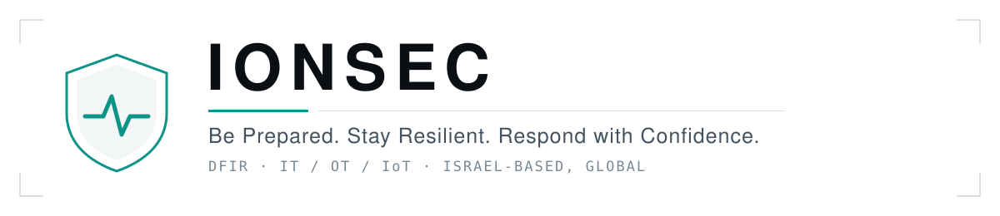

<picture>
  <source media="(prefers-color-scheme: dark)" srcset="https://raw.githubusercontent.com/ionsec/.github/main/profile/assets/banner-dark.svg">
  
</picture>

 

We are a cybersecurity firm working across **IT, OT, and IoT** networks, with **100,000+ hours**
of digital forensics and incident response behind us. This organization is where we publish the
tooling our analysts actually use during investigations.

---

## What we ship

| Project | What it is | |
|---|---|---|
| **[maes-platform](https://github.com/ionsec/maes-platform)** | M365 Analyzer & Extractor Suite — collection and analysis for Microsoft 365 investigations |  |
| **[OpenClaw-Threat-Intel](https://github.com/ionsec/OpenClaw-Threat-Intel)** | Multi-source threat-intelligence enrichment for incident response |  |
| **[FlareInspect](https://github.com/ionsec/FlareInspect)** | Cloudflare security assessment — CLI and local dashboard |  |
| **[Forti-DFIR](https://github.com/ionsec/Forti-DFIR)** | Fortinet VPN and firewall log parser for investigations |  |
| **[remnux-malware-triage](https://github.com/ionsec/remnux-malware-triage)** | Triage-first malware analysis workflow for REMnux |  |
| **[RansomProtect](https://github.com/ionsec/RansomProtect)** | Detects and blocks ransomware early in the infection chain |  |
| **[DO-Audit-Log-Scraper](https://github.com/ionsec/DO-Audit-Log-Scraper)** | Forensic export of DigitalOcean audit logs, which have no vendor API |  |
| **[Tikun13checker](https://github.com/ionsec/Tikun13checker)** | Readiness simulator for Amendment 13 to Israel's Privacy Protection Law |  |

We also maintain internal forks of [web-check](https://github.com/ionsec/web-check) and
[ESXiTri](https://github.com/ionsec/ESXiTri) for use in engagements.

---

## Services

**Cyber Preparedness** — risk and vulnerability assessment, security architecture review,
compliance readiness (ISO 27001, SOC 2, GDPR), tabletop exercises and IR planning.

**T3aaS — Tier 3 as a Service** — managed advanced security operations: threat detection and
response, threat hunting, event correlation and investigation, SOAR and threat-intel integration.

**Emergency Incident Response** — 24/7 hotline with a four-hour response commitment.
Containment and eradication, digital forensics, malware analysis and reverse engineering,
post-incident reporting.

---

## Focus areas

`DFIR` · `Malware analysis` · `Cloud and M365 security` · `OT / IoT security` ·
`Threat intelligence` · `Detection engineering` · `Identity and zero trust` · `Compliance`

---

## Working with us

Issues and pull requests are welcome on any public repository here. Please report security
vulnerabilities privately to **[info@ionsec.io](mailto:info@ionsec.io)** rather than
through a public issue.

 

**[ionsec.io](https://ionsec.io)** · **[info@ionsec.io](mailto:info@ionsec.io)** ·
**[LinkedIn](https://linkedin.com/company/ionsec)**

Active incident? Our 24/7 emergency response hotline is listed at
**[ionsec.io](https://ionsec.io)**.

